<div align="center">



</div>

### `$ cat about.md`

AI/ML & agentic systems engineer. I design the loop, the tools, the memory and the evals — then let agents do the heavy lifting.
I also ship web games, build robots (simulation first), and direct AI films, anime and ads.



### `$ ls capabilities/`



### `$ cat principles.txt`

```txt
ship > perfect        evals > vibes        sim before real
honesty > validation  measure, then claim  small loops, fast iterations
```

### `$ git log --oneline -1`

```txt
a9f3c21 (HEAD -> main) init: profile assembled by agents · first public repos incoming
```

<div align="center">



<sub>Every animation on this page is hand-written SVG — CSS keyframes + SMIL, zero JavaScript.</sub>

</div>
